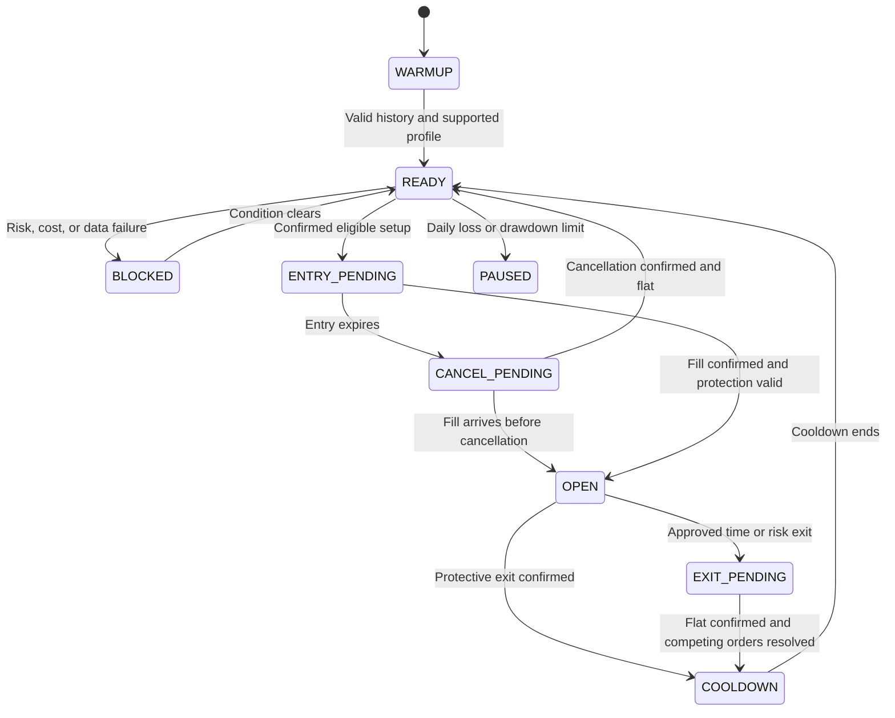

# BTC perpetual scalping v2: code review and improvement plan

Reviewed and updated 30 October 2026. Scope: code audit, implementation of the first safety/visibility improvements, and the next research plan. The objective remains a BTC perpetual indicator with useful LONG/SHORT signals, explicit entry/SL/TP, and evidence of positive expectancy after costs. Profitability has not been established.

Implementation update, 30 October 2026: the first safety, exact-timeframe, and diagnostic display changes are in the local Indie sources and TakeProfit working copies. Current status and remaining gaps are recorded at the end of this document.

## Recommendation

Repair execution and signal persistence before optimizing entry rules. The retained backtest orders confirm an exit race that opened unintended positions. The indicator also has a live-marker persistence defect and does not model the strategy's position lifecycle. Consequently the earlier results cannot establish the effectiveness of the intended scalping system.

The user confirmed that Pepperstone was only the chart opened for the screenshot; BTC perpetuals remain the target. Use a clearly identified perpetual feed for the next build and research. Binance BTC/USDT.P remains a provisional research feed, not the user's selected execution venue.

## Evidence and review boundaries

- Reviewed the attached screenshot, both local Indie files, their MCP working copies, and the original retained MCP report snapshots. Both local files match their working-copy source after newline normalization. The indicator's saved platform version is current according to ListUserScripts.
- The v1 source references and hashes in this review refer to the original working copies used by the archived reports, not the revised v2 source currently at the same repository paths.
- Archived all four original snapshots under `results/v1/`. These contain the report's recent-order/trade excerpts, not a newly downloaded complete ledger. They include the orders necessary to prove the two exit races below. The original runs were not recreated.
- Ran `node research/audit_v1.mjs --write`. Its assertions reconcile realized/open/total P&L and identify the overlapping exit fills. Results and source SHA-256 hashes are in `results/v1/audit.json`.
- Signal-persistence findings are established by control flow plus Indie execution documentation. A multi-update live replay is an implementation acceptance test still to perform; it was not performed in this audit. The screenshot alone cannot establish the exact active input values, explain every missing signal, or demonstrate profitability.
- Inspected TakeProfit's current docs for new-bar behavior, rollback, order delays, brackets, strategy higher-timeframe restrictions, timestamp units, and mutable series. The initial audit did not optimize parameters. The later implementation added manual UTC higher-timeframe aggregation and ran four corrected zero-trade backtests, recorded below.

## What the screenshot reveals

1. The selected chart is **Pepperstone BTC/USD, 15m**. MCP ticker lookup identifies that instrument as a CFD (`FXPPST`), while our experiments used Binance BTC/USDT.P (`CXBNF8`). Price paths, sessions, spreads, and contract economics must not be treated as interchangeable.
2. The visual hierarchy is dominated by two moving averages. Short green/red segments have no visible entry anchor, price annotation, setup ID, or outcome. Their purpose is difficult to understand without inspecting the indicator legend.
3. There is no clear current status: waiting for a setup, cost-blocked, pending entry, simulated position, or expired. The screenshot cannot tell us which state applies.
4. The plotted averages are EMA 20/50. The longer bias averages used to qualify trades are invisible. A crossing of the displayed lines is not itself the entry rule, but the interface does not explain that distinction.
5. No clearly readable LONG/SHORT label is visible in the supplied view. The live-marker defect below can explain disappearing labels, but it is not proof of the cause of every missing historical label in the screenshot.

## Prioritized code findings

Source references below refer to the reviewed v1 files. Preserve these versions as the baseline.

| Priority | Finding and evidence | Consequence | Required correction |
| --- | --- | --- | --- |
| P0 | Strategy lines 52-57 submit an ordinary opposite-side market order for a time exit while attached SL/TP remain active. The retained reports show both orders filling. | A second exit opens a new opposite position with no new setup or attached bracket. | A position-reducing exit mechanism with verified exchange/emulator semantics; an explicit exit-pending state and reconciled fills. |
| P0 | RESULTS.md originally labeled `realized_pnl` as net P&L and omitted open positions. | Equity, drawdown, trade count, and conclusions could be misread; rogue exposure was hidden. | Report realized P&L, unrealized P&L, total equity, open exposure, and exit invariants together. Correct the historical record. |
| P1 | Indicator lines 41-43 reset marker outputs to NaN on every calculation, but only assign a marker inside `is_new_bar`. | A live marker is emitted on the first update and replaced by NaN on later updates. Historical calculation can show a marker after reload. | Recompute the same confirmed decision on every update from immutable closed-bar inputs, or store/re-emit a stable per-bar event using verified rollback semantics. |
| P1 | Indicator lines 36-40 and 84/91 expire setup levels by bar index only. No fill, stop-hit, target-hit, cancellation, or position state is tracked. | Lines can outlive the setup, and new signals can overwrite previous levels. | A named setup lifecycle, immutable levels, and explicit modeled outcomes. Clearly label chart-only outcomes as simulated. |
| P1 | The indicator and strategy duplicate entry code, but only the strategy checks actual position/cooldown/order state. | The chart signal set is not the executed trade set. | One signal specification and shared/generated signal logic; separate candidate events from execution events. |
| P1 | Strategy line 36 gates all order and position observation behind `is_new_bar`. | Entries/exits occurring inside one bar may never be observed. Fill-based timeouts and cooldowns can be late or missed. | Observe fills, position transitions, rejections, and cancels on every supported update; gate only new signal decisions to completed bars. |
| P1 | Strategy line 50 drops the pending order handle immediately after requesting cancellation. | Cancellation and late/partial fills cannot be reliably reconciled. | Keep order identity until a terminal status is confirmed. No new entry while cancellation is unresolved. |
| P1 | SL/TP and sizing use `open[0]`, while the bounded limit can fill later at another price. See strategy lines 82-111. | Actual initial risk and reward/risk differ from displayed values; favorable price improvement can leave an invalid stop relative to the fill. | Record intended versus actual fill, verify stop side and risk on fill, handle gaps, and never widen protection after entry to conceal excessive risk. |
| P1 | Daily loss and drawdown pauses from the original plan are absent. Quantity is hardcoded to 0.001 BTC steps; notional is capped at approximately cash. | Risk fraction alone is not the full risk policy; lot and margin assumptions may be wrong for the chosen contract. | Venue metadata, margin-aware sizing, daily net-loss pause, drawdown halt, and explicit rounding/rejection checks. |
| P2 | Default inputs 60/150 do not change with chart timeframe or instrument. Original 15m preset was 80/200. The screenshot does not show these settings. | A user can unknowingly run the wrong preset or unsupported instrument. | Automatic 5m/15m profiles, visible profile/venue, and a blocked or explicit override state for unsupported charts. |
| P2 | Longer chart-timeframe EMAs substitute for higher-timeframe EMAs. The slope is over three execution bars, not three higher-timeframe bars. | The implementation is a different hypothesis from the original plan. | Exact completed higher-timeframe aggregation with independently checked EMA values and warm-up, or an explicitly named single-timeframe strategy. |
| P2 | Indicator line 64 and strategy line 81 consume cooldown before cost/stop/size eligibility passes. | Rejected candidates suppress later valid signals without explanation. | Separate raw candidate, accepted setup, filled trade, and post-exit cooldown timestamps; define whether rejection has any cooldown. |
| P2 | Warm-up is only `bias_slow_len + 5` execution bars. No explicit gap/session validation or user-facing rejection reason exists. | Early-window behavior and data defects can silently change signals. | Defined warm-up and missing-data policy, finite-value checks, and reason counts. |

### Confirmed exit race in the retained reports

**5m sensitivity:** On 8 October 2026 at 13:20 Manila time (05:20 UTC), stop order **66** bought 0.058 BTC to close short trade **17**. The already queued time-exit market order **67** also bought 0.058 BTC, opening long trade **18**. That trade remained open in the report.

**15m sensitivity:** On 10 September 2026 at 03:45 Manila time (9 September 19:45 UTC), take-profit order **15** bought 0.077 BTC to close short trade **5**. Time-exit market order **17** also bought 0.077 BTC, opening long trade **6**. That trade also remained open.

The code never passes through an observed flat state in these reversals. `_was_in_position` is a boolean, and `_time_exit_sent` remains true, which is consistent with the replacement position escaping the intended timeout. The reports show no subsequent new bracket for these market-order entries. These are concrete implementation failures, not normal losing trades.

| Run | Realized P&L | Open P&L | Total reported P&L | Interpretation |
| --- | ---: | ---: | ---: | --- |
| 5m base | $0.00 | $0.00 | $0.00 | No trades; no edge estimate |
| 15m base | -$24.98 | $0.00 | -$24.98 | Three closed trades; too small a sample |
| 5m sensitivity | -$110.44 | -$162.63 | -$273.07 | Unintended long after overlapping exits |
| 15m sensitivity | -$55.81 | +$345.54 | +$289.73 | Positive total includes unintended long exposure; not evidence of a scalping edge |

All original reports also have `is_history_depth_sufficient=false`. Their last-bar metadata does not match the requested end dates. Preserve the records, resolve time coverage, and rerun only after the execution defects are fixed. The earlier summaries missed the open positions; compilation/runtime success did not establish trading correctness.

### Why the current cost gate produces sparse signals

The baseline uses estimated round-trip cost `C = price * 0.0015`, accepts only `C / D <= 0.20`, and requires stop distance `D <= 2.5 * ATR`.

Therefore, an eligible setup must have:

- `D / price >= 0.0075`: a stop at least **0.75%** from entry.
- `ATR / price >= 0.003`: ATR at least **0.30%** of price, as a necessary condition, not a sufficient one.
- At an illustrative BTC price of $81,000, minimum stop distance is **$607.50**, and the 1.5R target is at least **$911.25** away.

This is a restrictive volatility requirement for a strategy with a six-bar holding objective. Measure the rejection distribution before choosing a new threshold. Do not manufacture more signals by understating fees or widening stops merely to pass the cost gate. The previous 5-basis-point filter experiment still charged approximately 10 basis points of round-trip commissions, so that input was economically inconsistent with the charged fees.

## Proposed v2 architecture

Use one deterministic decision specification with three parts:

1. **Market and signal engine:** validated venue/profile; completed candles; exact higher-timeframe trend; one entry rule; stop/target proposal; actual-cost estimate; eligibility and reason codes. Output a timestamped setup ID with direction and levels. Derive duplicate identity from symbol, venue, timeframe, signal-close timestamp, and direction.
2. **Execution engine:** pending orders, cancel acknowledgments, partial fills, actual average entry, bracket state, exit intent, realized P&L, cooldown, and risk limits. Process this state on every available event/update. A new signal can never override active order management.
3. **Visual renderer:** redraw stable event outputs and lifecycle state. The standalone indicator uses a documented fill model and labels it simulated; it cannot claim to know the user's actual exchange position. When a strategy has actual emulator fills, show actual simulated fill prices separately from planned prices.

Indie source sharing must respect its import/compiler restrictions. Use a shared source template or supported custom algorithm for the decision logic, with generated indicator/strategy artifacts and signal parity tests. Do not maintain two independently edited copies of the same conditions.

Partial fills and all exceptional transitions must retain order identity. PAUSED stops new entries but still manages existing protection. BLOCKED describes an entry decision; it must never halt protection of an existing position.

### Exit mechanism: mandatory capability check

The next implementation must prove that a close cannot increase absolute exposure or reverse its sign, including when SL/TP fills first. Prefer a verified reduce-only or position-bound close primitive. A documentation search in this audit did not find `reduce_only` or `close_position`; that is not proof the runtime lacks such a capability. Inspect the current builder API and run an isolated compiler/runtime probe.

If no atomic reducing close is supported, do not repeat the existing plain market close alongside a bracket. Keep the protective bracket as the sole exit in the first corrected native baseline, with the time-exit feature explicitly disabled, or establish a fully verified alternative execution mechanism. Cancel-then-close is not assumed safe: fills can race cancellation and cancelling protection creates an exposure interval. Any such mechanism needs acknowledgment handling and a demonstrated bounded-risk policy before use.

Recompute permissible risk at fill; preserve a valid protective stop while handling exceptions. Block new entries if any unexplained position, pending cancellation, or missing protection is detected. Risk and execution invariants outrank backtest performance.

### Exact trend context despite the platform restriction

TakeProfit's current playbook lists manual timestamp aggregation as a fallback for strategies that cannot use `calc_on(..., time_frame=...)`. Implement it in the shared engine:

- 5m execution: aggregate three complete 5m bars into a UTC-aligned 15m bar.
- 15m execution: aggregate four complete 15m bars into a UTC-aligned 1h bar.
- Publish only a bucket whose end time is at or before the signal decision. Update higher-timeframe EMA values once per completed bucket, and measure slope in those buckets.
- Discard partial starting buckets; flag incomplete/gapped buckets; use the same warm-up/seeding as an independent resampling reference. Require approximately 250 completed higher-timeframe bars initially.
- Compare to native indicator secondary-context values and an independent engine. Do not claim an EMA of 60 execution bars is identical to an EMA of 20 completed higher-timeframe bars.

This restores the intended hypothesis without relying on the unsupported strategy secondary context. It remains a planned implementation, not a tested feature.

## Visual design specification

See [the illustrative layout](V2_LAYOUT.svg). It is a design proposal with fictional prices, not a screenshot of implemented functionality or a trade recommendation.

| Element | Proposed behavior |
| --- | --- |
| LONG / SHORT marker | High-contrast text at the decision/entry-attempt bar; stable through intrabar updates and reload. Timestamp describes when information was available. |
| Entry | Clearly labeled yellow/white horizontal segment; show planned entry until fill, then actual simulated entry if available. |
| Stop | Red segment with price and stop percentage; light risk shading. |
| Target | Green segment with price and target R; light reward shading. One target initially. |
| Pending setup | Dashed levels with a visible expiry; label AWAITING FILL, not OPEN. |
| Completed setup | Stop extending levels; retain a small outcome label such as SIM SL, SIM TP, TIME EXIT, or CANCELLED. An ambiguous historical sequence is labeled AMBIGUOUS. |
| Current status | Compact panel: instrument/venue, 5m or 15m profile, higher-timeframe bias, lifecycle state, principal reason for no entry, and cost assumption in basis points and R. |
| Moving averages | Optional thin lines with explicit names. Keep the trading levels more prominent. No need to display every internal filter. |
| History control | Show the latest setup by default; optional last five or full history. No line joining between unrelated setups. |
| Numeric alerts | Stable, explicit outputs for long/short events and setup ID/timestamp; deduplicate by event identity. Avoid zero-price alert lines affecting chart autoscaling. |
| Research label | Display RESEARCH or PAPER until validation gates pass. No invented confidence percentage or uncalibrated win probability. |

Use text, line style, and color together so direction/status remains distinguishable without color. Keep panel size and history density configurable. Reuse drawing objects or bounded history collections to avoid chart slowdown. Verify rollback handling; a drawing created once on the first live update may disappear unless it is redrawn appropriately.

## Effectiveness research after correctness

The initial goal is an explainable, cost-adjusted edge. More filters, more signals, or a better-looking chart are not themselves performance improvements.

1. **Instrument rejection reasons.** Count raw setups, trend failures, no pullback, overextended trigger, excessive stop, excessive cost/R, position conflict, risk pause, and no fill. Measure time-of-day and volatility distributions using completed data only.
2. **Rebuild the reference result.** Run corrected v1 entry rules with valid lifecycle handling and realistic costs on both timeframes. Separate the effect of bug fixes, exact higher-timeframe bias, and entry-rule changes.
3. **Compare two entry families.** First, trend pullback with an explicit reset/rearm rule. Second, breakout then retest with expiry and an invalidation level. Write their rules before testing. Defer range reversion until there is enough evidence to justify a separate system.
4. **Avoid chasing expansion candles.** Test one predeclared distance-from-pullback or candle-range constraint, normalized by ATR. Its threshold must be chosen in training data and tested without retuning; do not select it from this screenshot.
5. **Keep stop logic causal.** Use completed structure plus volatility/tick buffer. A stop must represent invalidation and remain within the risk budget. Record maximum favorable/adverse excursion and exit reason to understand stop/target behavior.
6. **Compare exits conservatively.** Initially compare fixed 1.2R, 1.5R, and 2R targets. Time exits may be tested only after their execution is proven safe. Defer break-even moves, partial exits, and trailing stops until a simpler baseline demonstrates an edge after their full costs.
7. **Use a bounded experiment budget.** First candidate batch: 2 entry families x 2 execution timeframes x 3 targets = 12 configurations, plus 2 fixed corrected-v1 references. Log all 14. Additional filters or tuning constitute new trials and require a newly declared experiment; do not silently expand a parameter grid.
8. **Keep fee estimates truthful.** Use actual entry/exit fee tiers and consistent sizing, gating, and P&L costs. Evaluate different admissible cost/R thresholds only as explicit research variants; never lower the fee input to force signals through. Estimate break-even cost from results.

For full 1.5R wins and 1R losses with cost 0.2R per trade, break-even win rate is `(1 + 0.2) / (1 + 1.5) = 48%`. This arithmetic is a useful design check, not a predicted win rate. Actual partial fills, time exits, and gaps require the realized payoff distribution.

## Data and validation plan

**Data.** Obtain 12-24 months of one-minute BTC perpetual candles and funding history from the research venue; use finer trade data for ambiguous exits where available. Build 5m, 15m, and 1h candles from the same source with documented timestamps. Public futures archives offer a route around the chart account's history limit; downloads, coverage, and costs still need verification. Preserve source/checksums, gaps, warm-up, funding timestamps, and fee assumptions. Start collecting real spreads/slippage for forward comparison. One-minute OHLC alone does not reveal every intrabar sequence.

**Splits.** Freeze chronological training/validation windows and a final untouched holdout before selecting parameters. Treat the October screenshot and every prior inspected period as development evidence, not a fresh holdout. Use rolling training and subsequent validation periods, purge boundary-crossing trades, and preserve history only for warm-up. A holdout that has been used to change a rule is no longer untouched.

**Execution.** Model taker costs conservatively for aggressive orders, venue rounding, latency, missing/unfilled entries, partial fills where the data supports them, and funding when positions cross settlement. For unresolved SL/TP order sequence, report a pessimistic outcome and a sensitivity range. At the test end, disclose remaining exposure and either value it explicitly or apply a predefined forced-close convention with costs; never report only closed P&L as total return.

**Reports.** Include net expectancy in R and money, profit factor, total equity and drawdown including open positions, trade counts, rejection/fill rates, exposure, holding time, long/short results, and stability across periods. Include every failed variant. Estimate uncertainty with day/week block resampling. Test neighboring parameters and increased spread/slippage. Selection from many trials inflates apparent success, so a positive point estimate alone is inadequate.

**Initial acceptance gates.** No execution invariant failures or unexplained positions; sufficient clean unseen coverage; aim for at least 300 completed out-of-sample trades across different conditions; positive net expectancy with a positive lower confidence bound when sample quality permits estimation; net profit factor at least 1.25; drawdown at most 8% under the proposed 0.25% risk policy; positive expectancy under doubled adverse spread/slippage while keeping fees and funding; and no dependence on one narrow parameter optimum. These are screening targets, not promised outcomes. Separate long/short samples must be adequate for any direction-specific claim.

After selection, require at least 4-8 weeks and 100 completed paper trades, whichever takes longer, with timestamps/fills/costs reconciled. If the gates fail, reject or redesign the candidate rather than call it profitable. Forward time cannot be replaced by another historical parameter search.

## Implementation milestones and acceptance tests

| Order | Deliverable | Required evidence before advancing |
| --- | --- | --- |
| 1 | Archived v1 evidence and corrected results | Complete for retained v1 snapshots; full historical ledgers are unavailable |
| 2 | Execution capability probe and lifecycle repair | Time exit disabled and pending-entry cancellation tracked; still needs deterministic fill/cancel/OCO tests before lifecycle is accepted |
| 3 | Shared confirmed signal engine and exact trend aggregation | UTC 5m→15m and 15m→1h close aggregation implemented with gap checks; independent EMA parity and candidate-ID parity remain unverified |
| 4 | Persistent visual and alert outputs | Stable candidate markers, modeled levels, dashboard, and rejection counters implemented; realtime replay, alert parity, and reload checks remain |
| 5 | Cost/data pipeline and corrected baseline reports | Four corrected short-window runs captured, but all have zero trades, insufficient history flags, and report timestamps after requested end dates |
| 6 | Bounded candidate comparison | Predeclared trials and validation folds; complete result table and uncertainty; final holdout used once |
| 7 | Paper validation and deployment decision | All correctness and performance gates pass; chosen venue and fee tier confirmed |

Critical regression cases for stages 2-4: SL or TP coincides with a timed exit; fill occurs after cancellation request; partial entry remains pending; entry and exit both occur inside one candle; adverse gap through planned stop; duplicate tick/update; disconnect/reload; incomplete higher-timeframe bucket; fee/spread spike; min-size/tick rounding; daily-loss pause with an open position; and end-of-test position accounting. Use small deterministic fixtures for behavior and platform replay for execution semantics. Compilation alone does not satisfy these tests.

## Sources checked for this plan

- [TakeProfit execution mechanics](https://takeprofit.com/docs/indie/Strategies/Strategy-mechanics): delayed order actions and emulator/live distinctions.
- [TakeProfit order brackets](https://takeprofit.com/docs/indie/Strategies/Orders): attached protective orders, OCO behavior, and position-level effects.
- [TakeProfit drawing state](https://takeprofit.com/docs/indie/Code-examples/common-drawing-patterns): historical versus realtime updates and rollback behavior.
- TakeProfit MCP `GetPlaybook(section="secondary-context")`: strategy timeframe restriction and manual timestamp aggregation fallback; retrieved 30 October 2026.
- [Binance public data repository](https://github.com/binance/binance-public-data): futures candle/trade archives and checksums.
- [Binance futures market-data API](https://developers.binance.com/en/docs/catalog/core-trading-derivatives-trading-usd-s-m-futures/api/rest-api/market-data): funding history and market-data interfaces.
- [Bailey et al., The Probability of Backtest Overfitting](https://www.davidhbailey.com/dhbpapers/backtest-prob.pdf): selection risk from repeated strategy trials.

## Implementation status, 30 October 2026

Implemented in the current working copies:

- Removed the ordinary timer market exit that raced the attached SL/TP bracket in v1. The six-bar time exit remains **disabled** until a position-reducing close can be verified against protective orders.
- Kept entry-order identity during cancellation, requested cancellation once after one bar, and blocked new entries until a terminal order state. The strategy observes flat/position transitions on every calculation. These paths still need a deterministic fill/cancel lifecycle test; the current performance runs created no orders.
- Added quantity-step rounding and platform minimum-order-size/value checks. The user's venue, contract specs, fee tier, tick size, and leverage remain unconfirmed.
- Replaced the chart-EMA bias proxy with UTC-aligned completed-bucket calculations: 5m execution uses 15m EMA(20/50); 15m execution uses 1h EMA(20/50). The code checks all expected component timestamps, resets after gaps, uses a 250-higher-timeframe-bar warm-up, and compares the slow EMA with its value three completed higher-timeframe candles earlier. The slope offset had a one-bar error in the first implementation and is corrected in the current source.
- Earlier screenshots of platform versions 6 and 7 showed the completed-HTF counter stuck at 0 and then 1. The boundary check was changed to integer UTC bucket-ID changes; the later audit found the diagnostic integer series also needed persistent initialization. Platform version 8 contains that counter fix; the user's latest screenshot predates the save, so chart-side progression remains unconfirmed.
- Added visible higher-timeframe EMA lines, stable current-bar signal markers, model entry/stop/target values, the chart instrument/profile, estimated cost in R, and historical counts for trend, pullback, trigger, model setup, stop-rejection, and cost-rejection bars. The indicator labels fills as assumed because it cannot read the user's exchange position.

Historical TakeProfit checks on the earlier source: strategy working copy `6daa5166-bfc5-4960-8f84-e714a3b2aff2`, script version 8; indicator working copy `dd7d1e3f-a6db-4f3a-8a50-2b8f551e9db3`, script version 11, saved as platform version 7 of private UID `b0WWgU3721kqgpvBweE24`. The latest source/version results are recorded below. The library title still says v1 although the current code title is v3. Strategy saving remains unsupported by the MCP endpoint.

The first four corrected research backtests on Binance `BTC/USDT.P` reported zero trades: 5m and 15m at a 15 bp cost filter, and 5m and 15m at a fee-only 10 bp filter. After changing bucket detection to integer UTC bucket IDs, strategy v8 was re-run on both timeframes at 15 bp; both also reported zero trades. All six reports have `is_history_depth_sufficient=false`. The lower-cost diagnostic excludes spread, slippage, and funding and is not a profitability result. Zero trades mean win rate, expectancy, and profit factor are undefined. The report `last_bar_at` values also extend beyond the requested date windows.

The screenshot posted at approximately 03:14 Manila time still showed `HTF WARMUP | 1/250`; the counter fix was saved as platform version 8 at approximately 03:21 Manila time, so that screenshot predates the corrected build. Reload/add v8 and confirm completed HTF bars increment. The strategy's version 9 base-cost rerun produced 0 trades on 5m and 4 trades on 15m (-$31.30 total, 25% wins, 0.47 profit factor, -$7.82 expectancy); both runs still flag insufficient history and date metadata mismatch. No profitability claim is supported.

Remaining work at the previous milestone: independently compare the custom EMA stream with UTC-resampled reference candles; confirm chart counter progression; test bracket and pending-order lifecycle with actual fills; obtain longer clean data and realistic venue costs; add daily loss/equity drawdown locks; and run the predeclared validation only after the candidate emits enough valid trades to measure. Do not lower the cost assumption or relax filters merely to manufacture signals.

## Confirmed setup pass, 30 October 2026

Both scripts now read `self.time_frame.to_seconds()` to select the 5m→15m or 15m→1h profile. A higher-timeframe rollover updates only once on a new execution bar. Timestamp discontinuities and incomplete higher-timeframe buckets clear the EMA warmup and pending pullback state. Pullbacks arm once, expire after six execution bars, and are consumed on the first trigger; trend change or a data gap resets the setup. The indicator mirrors the strategy's bracket-only model duration and three-bar post-exit cooldown, adds a modeled entry line, and consolidates the dashboard with status, data, pipeline, levels, and estimated break-even.

The TakeProfit strategy working copy is v12 and the indicator working copy is v15; both compile and pass `runtime_quick` on 5,000 candles. The indicator is saved as platform version 9. The corresponding strategy backtests produced zero 5m trades and eight 15m trades at -$45.28 net, with 25% wins and 0.58 profit factor on 15m. Both runs flag insufficient history and their reported last bars exceed the requested date ranges. They are correctness diagnostics, not a profitability finding.

The six-bar pullback expiry is not a trade exit. The model stays active until its modeled stop or target, matching the strategy's current bracket-only behavior and avoiding the known opposite-side timed-exit race. Safe time exits remain a separate execution project because canceling or replacing a live bracket must be verified before using them.

Next: apply platform version 9 to the Binance BTC perpetual chart and verify that its completed 15m-bar counter advances; compare the manual EMA series against UTC-resampled Binance candles; record candidate-ID parity between indicator and strategy; then resolve clean history coverage and cost inputs. Do not optimize entry thresholds on the current short, date-mismatched windows.

## Findings addressed in the current implementation — 30 October 2026

The previously identified rollback defect is corrected in both scripts: higher-timeframe EMA/count assignments recalculate on each update inside the current bucket from committed prior-bar values and the last closed lower-timeframe candle, while one-time class diagnostics remain new-bar gated. This code-level change is compile/runtime-checked, but a live chart boundary replay and reload check remains outstanding.

Pullback lifecycle now stores the qualifying source candle and original extreme, consumes each touch once, fixes the six-bar expiry at first arming, and resets on data gaps or bias changes. The consumed-touch watermark advances to the decision bar on expiry, invalidation, or trigger, so rearming requires a later touch outside the already-observed rolling window. It invalidates after a completed close crosses the slow EMA or price breaches the stored extreme by 0.1 ATR. The trigger candle must close beyond both entry EMAs, and the strategy and indicator use this same added guard. Indicator counter flags now reset each new candle and cumulative series values are assigned idempotently. The panel exposes source-bar ID, age, structural invalidation price, and research/assumed-fill status.

Current source versions are strategy working copy v14 and indicator working copy v19 (private saved platform version 13). Both pass compile and 5,000-candle runtime validation. New Binance BTC perpetual tests returned one winner on 5m (+$32.49) and two losing trades on 15m (-$39.82; PF 0). The reports still flag insufficient history and end after their requested dates. Treat these only as code checks, not evidence of positive expectancy. The indicator code title now says v5 - Research; the original platform library title remains v1 because the save endpoint rejects title changes after a script's first save.

Still open: verify the new counter on a live/reloaded chart; compare custom HTF values with independent UTC-resampled candles; prove strategy/indicator candidate parity; resolve data-window bounds; test fills, cancellations, and brackets; and confirm costs. Daily loss and equity drawdown locks were not added because the available strategy API search confirmed available cash and position but did not establish a reliable equity or realized-daily-P&L series. The complete current assessment is in `docs/CURRENT_ASSESSMENT.md`.
